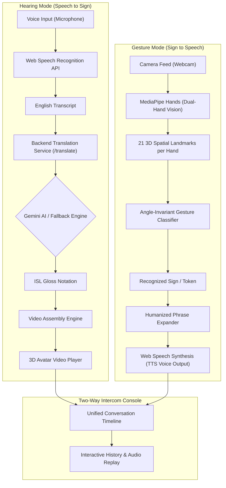

# SoundSigns: Real-Time Bidirectional Speech & Sign Language Communication System

SoundSigns is an interactive, bidirectional web application that bridges real-time communication between spoken English and sign language. The system provides a seamless two-way bridge: translating spoken speech into animated International Sign Language (ISL) video sequences, while simultaneously using camera-based computer vision to track hand gestures and speak them aloud in natural human voice.

---

## Key Highlights

- **Bidirectional Communication**: Supports one-way translation and interactive two-way conversation with a split-screen console.
- **Hearing Mode (Speech to Sign)**: Real-time speech-to-text, AI-driven ISL gloss translation (Google Gemini with rule-based fallback), and a 3D animated signing avatar.
- **Gesture Mode (Sign to Speech)**: Real-time camera vision powered by Google MediaPipe Hands, interpreting single-handed and coordinated two-handed gestures across varied angles into synthesized spoken voice.
- **Gesture Training Studio & Gallery**: Integrated gallery of 40+ signs plus a live calibration studio to train and save personalized custom gestures.
- **Emotionally Expressive Voice Synthesis**: Text-to-speech with natural neural voice prioritization and customizable emotional tones (*Soft*, *Friendly*, *Gentle*).
- **High-Contrast Accessible UI**: Engineered with an ultra-clean, high-contrast dark theme (`#000000` background, `#DDE3E7` text, and `#004AFF` primary accent) built for maximum visual clarity.

---

## System Architecture



---

## Core Features & Modules

### 1. Hearing Mode: Speech to Sign Language
- **Live Speech Transcription**: Captures continuous microphone audio via the browser Web Speech API with real-time status and volume visualization.
- **ISL Gloss Translation Engine**:
  - Leverages Google Gemini Flash (`gemini-flash-latest`) via the Flask backend to convert standard English syntax into standard ISL grammar (Time - Subject - Object - Verb).
  - Built-in rule-based fallback engine automatically handles translations if API access is offline.
  - Automatically handles finger-spelling for proper nouns and vocabulary outside the core lexicon.
- **3D Avatar Video Synthesis**: Concatenates pre-rendered sign video clips into fluent sentence demonstrations with playback rate controls, replay, and loop capabilities.
- **Offline Video Export**: Generates and downloads compiled video files for offline review and learning.

### 2. Gesture Mode: Camera Vision & Hand Tracking
- **Dual-Hand Tracking with MediaPipe**: Tracks up to 2 hands simultaneously (`maxNumHands: 2`) with balanced tracking thresholds for high recall and minimal jitter.
- **Angle-Invariant Geometric Classification**:
  - Computes 3D local coordinate frames, palm vectors, knuckle axes, and finger extension ratios.
  - Recognizes gestures accurately whether the hand is held upright, tilted, or sideways.
- **Single-Hand vs. Dual-Hand Disambiguation**:
  - Automatically suppresses single-handed triggers when two hands are active to eliminate false positives.
  - **Thumbs Up (👍)**: Closed fist with thumb extending upward = speaks **"Yes"**.
  - **Thumbs Down (👎)**: Closed fist with thumb pointing downward = speaks **"No"** (strictly single-hand only).
  - **Closed Fist (✊)**: Plain fist with thumb folded across fingers speaks **"Solid / Fist"**.
  - **Two-Handed Signs**: Recognizes joined heart (`🫶`), double thumbs up (`👍👍`), applause (`👏`), and welcome (`🤗`).
- **Sign Gallery Modal**: Browsable catalogue of all 40+ built-in gestures organized by category (two-handed, everyday signs, alphabet, numbers) with instant audio preview.
- **Custom Gesture Training Studio**: Enables users to record custom landmark patterns, label them, and calibrate recognition vectors stored locally in the browser (`localStorage`).

### 3. Two-Way Intercom Console
- **Flexible Workspace Views**: Toggle between **Split View** (dual panels side-by-side), **Hearing Mode Focus**, or **Gesture Mode Focus**.
- **Interactive Timeline**: Logs conversational turns from both participants with timestamps and visual speaker badges.
- **Message Audio Playback**: Click any message in the history log to replay it aloud through the speech synthesis engine.

### 4. Expressive Text-to-Speech (TTS)
- **Neural Voice Selection**: Automatically discovers and prioritizes the highest-quality natural/neural voice available in the client operating system and browser.
- **Humanized Phrasing**: Translates concise sign words (e.g., "Hello", "Yes", "No") into warm, complete conversational statements.
- **Voice Emotion Profiles**:
  - **Soft**: Heartfelt, caring warmth and expressive inflection (`basePitch: 1.08`, `baseRate: 0.92`).
  - **Friendly**: Upbeat, energetic, and welcoming cadence (`basePitch: 1.12`, `baseRate: 0.95`).
  - **Gentle**: Patient, soothing, and soft human tone (`basePitch: 0.98`, `baseRate: 0.88`).

---

## Project Structure

```
Sound-Signs/
├── backend/
│   ├── .env                       # Backend environment configuration (API keys)
│   ├── requirements.txt           # Python dependency specifications
│   └── transcription.py           # Flask server, Gemini ISL prompt & rule-based parser
├── frontend/
│   ├── public/                    # Static web assets
│   ├── src/
│   │   ├── assets/
│   │   │   └── videos/            # Pre-rendered 3D sign avatar MP4 dataset
│   │   │       ├── letters/       # Alphabet A-Z videos
│   │   │       ├── numbers/       # Numbers 0-9 videos
│   │   │       └── words/         # Core vocabulary videos
│   │   ├── components/
│   │   │   ├── App.jsx            # Main app shell & mode switching
│   │   │   ├── GestureTerminal.jsx# Camera feed, MediaPipe loop & gesture studio
│   │   │   ├── gestureClassifier.js# 3D vector geometry, multi-hand classifier & gallery
│   │   │   ├── ISLVideoPlayer.jsx # Video concatenation player & playback controls
│   │   │   ├── ISLVideoSection.jsx# Avatar player wrapper container
│   │   │   ├── ISLGlossSection.jsx# ISL gloss display & token breakdown
│   │   │   ├── LiveTranscriptSection.jsx # Speech input & transcript display
│   │   │   ├── TwoWayIntercom.jsx # Split-screen conversation console & timeline
│   │   │   ├── ttsUtils.js        # Voice synthesis, emotion tuning & phrasing
│   │   │   ├── wordDatabase.js    # Sign library definitions & dictionary lookup
│   │   │   └── Header.jsx         # App header, microphone toggle & mode selectors
│   │   ├── contexts/
│   │   │   └── ThemeContext.jsx   # Theme state provider
│   │   ├── hooks/
│   │   │   └── useSpeechRecognition.js # Web Speech API integration hook
│   │   ├── index.css              # Global styles & Tailwind directives
│   │   └── main.jsx               # React entry point
│   ├── package.json               # Node.js project manifest & dependencies
│   ├── tailwind.config.js         # Tailwind configuration & typography rules
│   └── vite.config.js             # Vite build settings & dev server configuration
└── README.md                      # Project documentation
```

---

## Tech Stack & Dependencies

### Frontend
- **Framework**: React 18
- **Build Tool**: Vite 4
- **Styling**: Tailwind CSS 3 (configured with dark-mode first design tokens)
- **Computer Vision**: Google MediaPipe Hands (`@mediapipe/hands` v0.10)
- **Icons**: Lucide React
- **Web APIs**: Web Speech API (`webkitSpeechRecognition`, `speechSynthesis`), MediaDevices API (`getUserMedia`), HTML5 Canvas 2D

### Backend
- **Server**: Python 3.8+, Flask, Flask-CORS
- **AI Model**: Google Gemini API (`gemini-flash-latest` via `google-genai` / `google-generativeai`)
- **Environment**: `python-dotenv`

---

## Installation & Setup

### Prerequisites
- Python 3.8 or higher
- Node.js 16 or higher (with npm)
- Google Gemini API key (obtainable from [Google AI Studio](https://aistudio.google.com/app/apikey))
- Modern browser with Web Speech API and webcam support (Google Chrome or Microsoft Edge recommended)

---

### Step 1: Backend Setup

1. Navigate to the `backend/` directory or install from project root:
   ```bash
   pip install flask flask-cors python-dotenv google-genai numpy sounddevice
   ```

2. Create a `.env` file inside the `backend/` directory:
   ```env
   GEMINI_API_KEY=your_gemini_api_key_here
   ```

3. Start the Flask translation server:
   ```bash
   python backend/transcription.py
   ```
   *The backend will run at `http://localhost:5000` with endpoints `/translate` and `/health`.*

---

### Step 2: Frontend Setup

1. Open a new terminal and navigate to the `frontend/` directory:
   ```bash
   cd frontend
   npm install
   ```

2. Start the Vite development server:
   ```bash
   npm run dev
   ```

3. Open your browser and navigate to the displayed local address (typically `http://localhost:3000` or `http://localhost:5173`).

---

## API Reference

### `POST /translate`
Translates English text into International Sign Language (ISL) gloss notation.

**Request Body:**
```json
{
  "text": "Hello, how are you today?"
}
```

**Response:**
```json
{
  "isl": "TODAY YOU HOW HELLO",
  "mode": "gemini_ai"
}
```

### `GET /health`
Returns the operational health status of the translation service.

**Response:**
```json
{
  "service": "ISL Translator",
  "status": "healthy"
}
```

---

## Gesture Recognition Reference

| Gesture | Icon | Output Word | Hands | Description |
| :--- | :---: | :--- | :---: | :--- |
| **Thumbs Up** | 👍 | "Yes" | 1 Hand | Closed fist with thumb extending upwards across angles |
| **Thumbs Down** | 👎 | "No" | 1 Hand | Closed fist with thumb extending downwards (single-hand only) |
| **Closed Fist** | ✊ | "Solid / Fist" | 1 Hand | Tight closed fist with thumb folded over fingers |
| **Two-Handed Heart** | 🫶 | "Love / Care" | 2 Hands | Joined thumbs and index fingertips forming a heart |
| **Double Thumbs Up**| 👍👍 | "Awesome / Great job"| 2 Hands | Simultaneous thumbs up on both hands |
| **Open Hands / Welcome** | 🤗 | "Welcome / Together" | 2 Hands | Both hands open, palms facing forward |
| **Clap / Applause** | 👏 | "Congratulations" | 2 Hands | Open palms approaching each other |
| **Wave / Open Palm** | 👋 | "Hello" | 1 Hand | 5 extended upright fingers spread open |
| **Peace / Victory** | ✌️ | "Peace" | 1 Hand | Index and middle fingers extended in a V-shape |
| **I Love You (ILY)** | 🤟 | "I love you" | 1 Hand | Thumb, index, and pinky extended; middle and ring curled |
| **Finger Heart** | 🫰 | "Love" | 1 Hand | Thumb and index crossing in mini-heart shape |
| **Pointing / One** | ☝️ | "You / One" | 1 Hand | Index finger extended upright |
| **OK Sign** | 👌 | "I understand" | 1 Hand | Thumb and index fingertip touching in an O-shape |
| **Alphabet (A-Z)** | 🅰️–🇿 | Letter Name | 1 Hand | Complete fingerspelling sign language alphabet |
| **Numbers (0-9)** | 0️⃣–9️⃣ | Number Name | 1 Hand | Counting and numerical hand shapes |

---

## User Interface & Design System

The application strictly adheres to high accessibility and low visual fatigue standards:
- **Pure Dark Palette**: Background `#000000`, neutral high-readability text `#DDE3E7`.
- **Primary Accent**: Pure high-contrast blue `#004AFF`.
- **Typography**: Clean, readable sans-serif typography with generous line heights and distinct visual hierarchy.
- **Natural Iconography**: Realistic standard emojis without unnatural tinting.
- **Clean Flat Aesthetic**: High-clarity solid styling with crisp borders and zero color blending.

---

## Dataset Attribution

The sign language video dataset is sourced from the open-source *"Text-Speech to Sign Language Generator"* project by JS-Coderr (2024), available on GitHub.
